# Focanopy

**Android 1.11:** redesigned focus cards, stable bottom navigation, grouped settings, adaptive timer text and consistent accessible icons. [Download the Android release](https://github.com/ashu-sa/cyber-cat/releases/tag/v1.11.0).

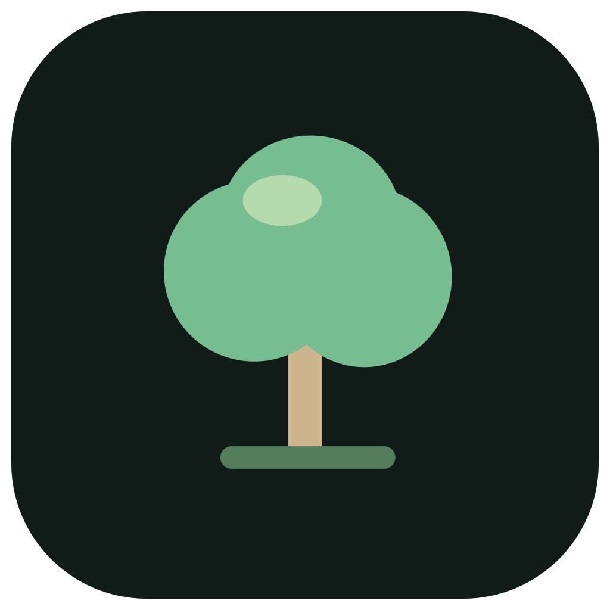

**Make room to grow.** An Android-first focus stopwatch that turns your time into a living forest, with native companion apps for macOS, Windows and Ubuntu.

Focanopy combines **focus + canopy**: start a session, watch gentle water droplets nourish your tree, and build a garden from a day of focused work.

[Download the Android APK](https://github.com/ashu-sa/cyber-cat/releases/latest/download/Focanopy-Android-debug.apk) · [All releases](https://github.com/ashu-sa/cyber-cat/releases/latest) · [Build checks](https://github.com/ashu-sa/cyber-cat/actions/workflows/build.yml)

## Android — the main MVP

A complete native Kotlin experience: readable stopwatch, persistent background notification, optional floating tree, calendar journal and simple cross-device accounts. Everything needed for local focus works without an account.

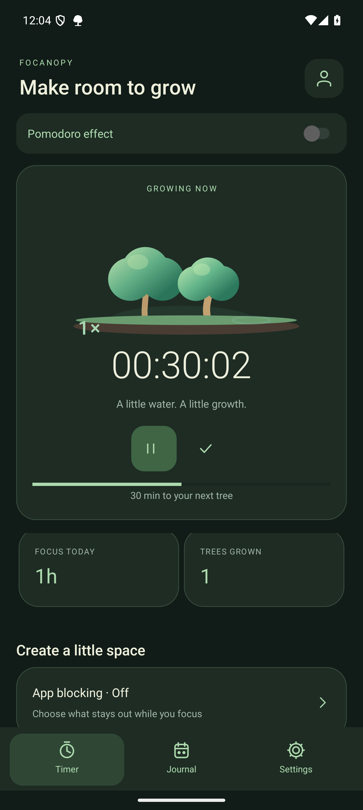 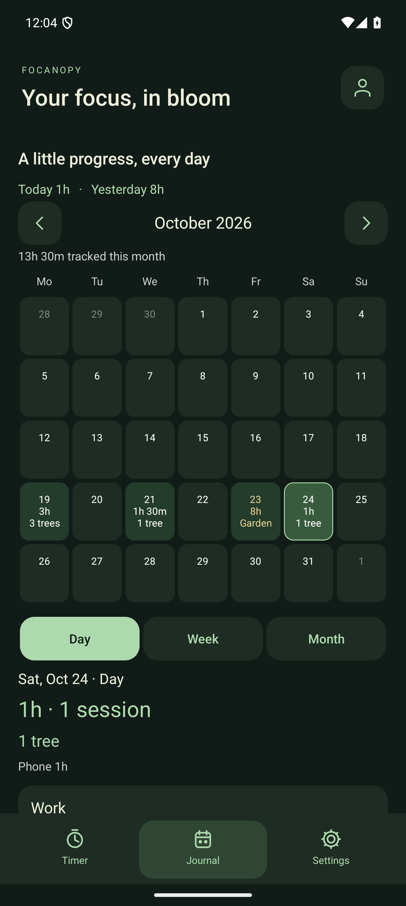

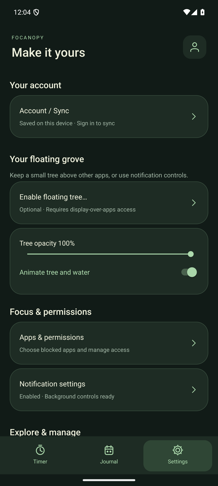 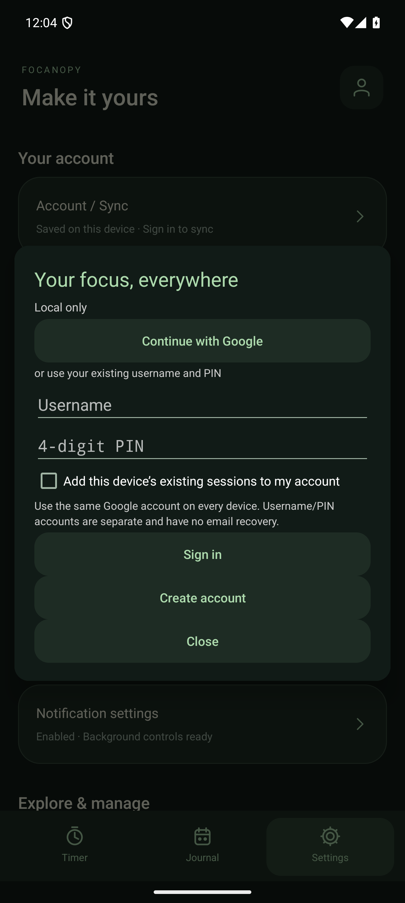

Screenshots are captured from the actual native Android app on an isolated Android 15 emulator using sample sessions. They are not mockups or personal activity records.

### MVP features

- **Accurate focus timing:** start, pause, resume, finish and recover an unfinished session. Uses monotonic elapsed time, not an incrementing counter; breaks are excluded.
- **Background controls:** Android foreground service with a system chronometer and Pause/Resume/Finish actions. No overlay permission required.
- **A growing companion:** native Canvas tree, slow water droplets, gentle sway, reduced-motion support, and next-tree progress. Pausing gives the plant a dry, dormant appearance and stops water; resuming revives green foliage and watering.
- **Optional floating tree:** drag from the tree, timer, controls or empty space above other apps, adjust opacity, hide/show, and use compact icon controls. Finishing stops time even when Android blocks opening the naming screen.
- **Save without friction:** Job Apply, Upskill, Interview Prep, Work or a custom name. Close the popup and your typed name remains available; Resume continues the same unsaved session and Reset starts fresh. Save opens the journal.
- **Useful history:** month calendar, Day/Week/Month summaries, daily trees, garden days, device totals, rename, delete confirmation and undo.
- **Local data ownership:** atomic private JSON history and document-picker JSON export. Existing history is preserved on upgrade.
- **Optional cloud account:** username + four-digit PIN; remembered secure login, offline changes, cross-device sessions, deletion sync and explicit conflict resolution.

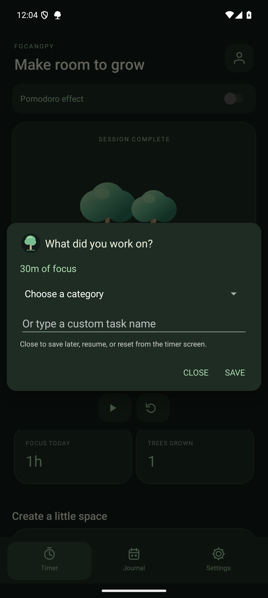 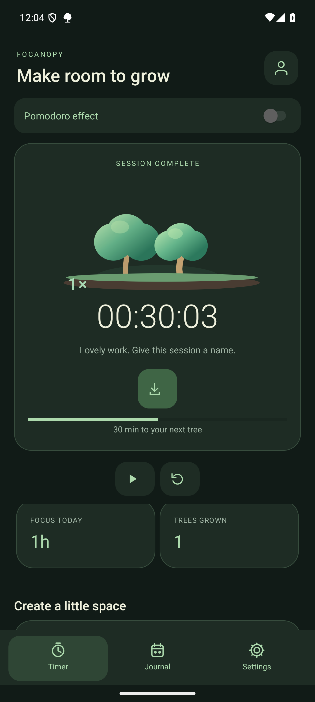

### Stopwatch with an optional Flower Pomodoro

Pomodoro shares Focanopy’s forest-green surfaces, warm cream countdown, rounded cards and soft flower accents. Focus, break and cancelled states each have a clear title, with compact controls and quieter app-blocking settings. Cancelled trees now visibly wither over 3.4 seconds: watering stops, petals fall, leaves fade and the stem bends into a dry, bare shape. Open **Fast-forward tree preview** to watch seed → bloom → next tree → cancellation without changing your timer or history.

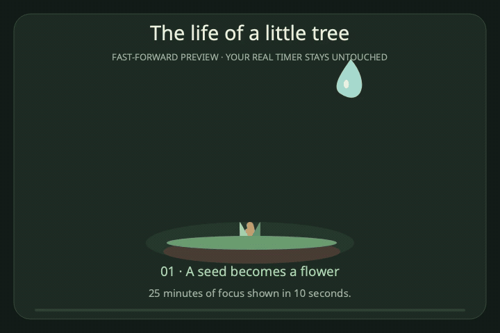

A second **Focus time** clock shows elapsed focus alongside the countdown and freezes during pauses and breaks. Apps & permissions lists app icons with individual blocking switches; one toggle blocks all apps except browsers, with per-app exceptions.

Start with the default stopwatch, or enable the optional **Pomodoro effect**: 25 minutes of focus grows a pink flowering tree, followed by a 5- or 10-minute break. Watering stops for the break, a gentle reminder asks you to move, and another invites you back. **You start every next round yourself.** Completed 25-minute rounds save automatically. Pomodoro has no Finish button: cancelling an unfinished round kills its tree and discards that partial round; previously completed rounds stay saved. Breaks never count toward focus time.

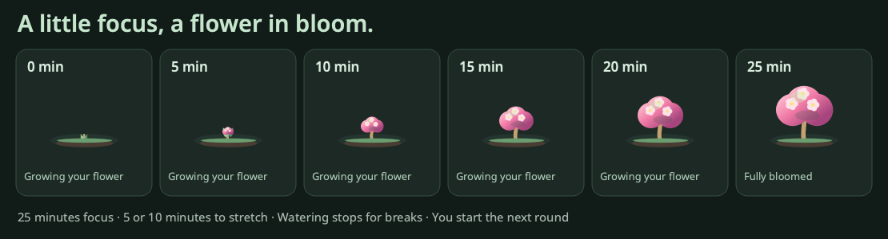

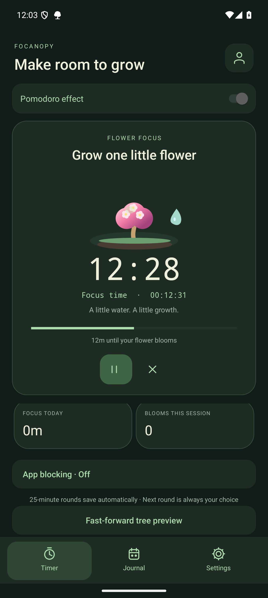 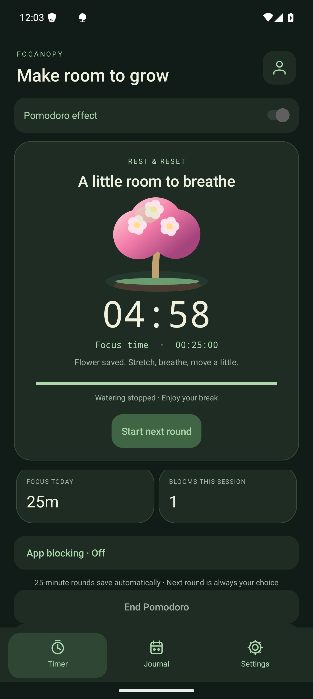 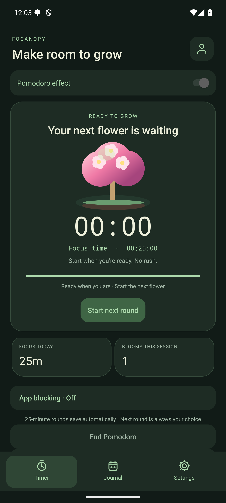

Optional app blocking works with the default stopwatch and Pomodoro focus. Block selected apps, or all apps except browsers and your exclusions. Android uses an explicitly enabled Accessibility service; macOS adds a blocking shield plus optional window minimization; Windows minimizes windows; Ubuntu/GNOME uses an optional user-enabled shell extension. Apps stay open, and pauses/breaks release blocking. See [Pomodoro and app-blocking setup](POMODORO.md) for controls, permissions and platform limits.

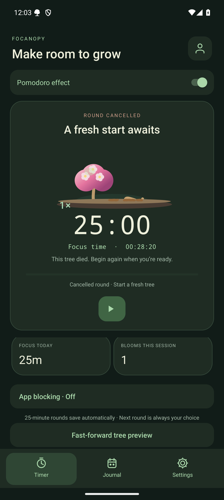

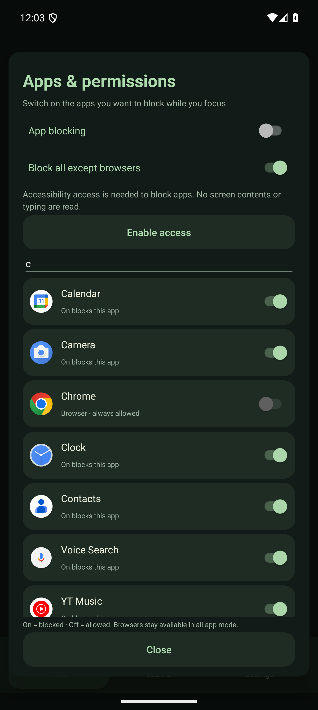

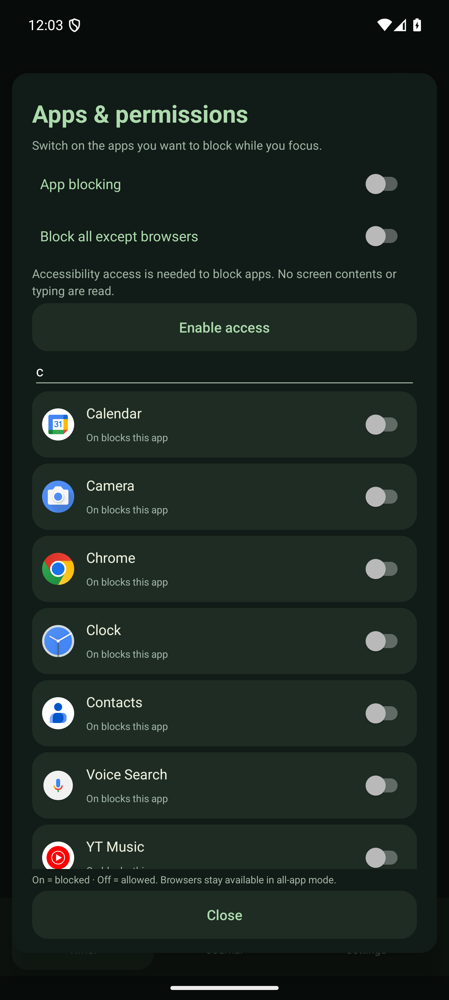

### Google sign-in

**Account / Sync → Continue with Google** is available on Android, macOS, Windows and Linux. Sign in once with the same Google account to share your journal across devices. Existing username/PIN sign-in is still available. Google uses the system browser, PKCE and the existing secure account caches.

**Owner setup required:** Google is currently disabled in the hosted Supabase project. Complete the [one-time Google OAuth setup](backend/GOOGLE_SIGN_IN.md) before live Google sign-in can succeed. No client secret ships in the apps. Until enabled, the Google button shows a setup message; username/PIN accounts and offline timing continue to work.

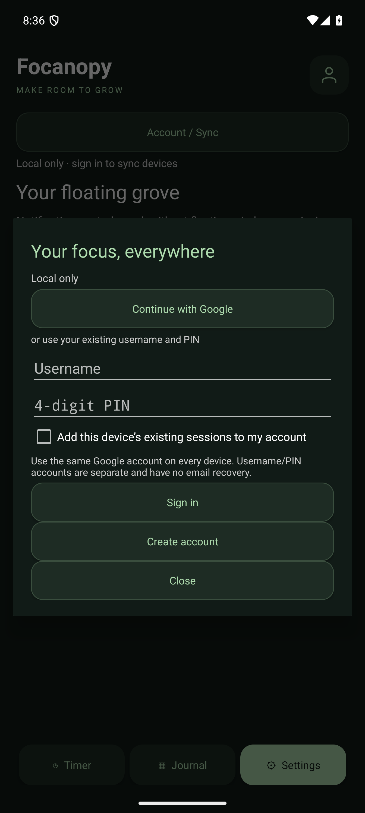

### Fast-forward preview on macOS

Run `./macos/simulate-growth.sh` to open a separate native simulator using the app’s actual tree renderer. One hour takes 10 seconds by default, with speed, scrub, pause, restart and next-tree controls. Preview time is never saved to your timer or history.

### Grow a forest

| Focus time | Reward |
|---|---|
| Every minute within the current hour | Trunk, leaves and crown grow a little |
| Every completed hour | A completed tree stays visible beside the next sprout |
| 8 hours of saved focus in a single day | Garden badge |

Short sessions add up, including synced sessions from different devices. Rewards derive from saved focus durations, so old history gets rewards and edits/deletions recalculate them. Pauses do not count. Days use the session’s local start date; week/month views count garden days rather than treating eight separate one-hour days as a garden.

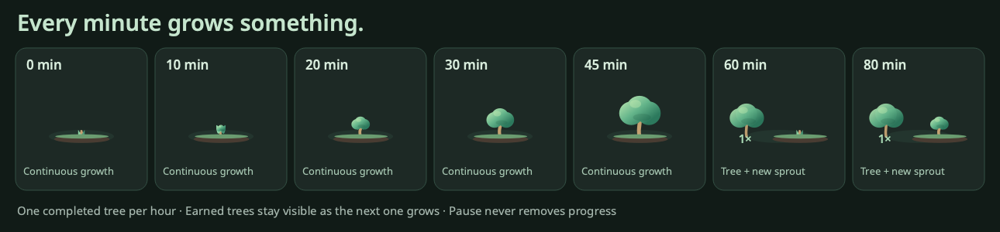

## Try it

1. Install the [Android APK](https://github.com/ashu-sa/cyber-cat/releases/latest/download/Focanopy-Android-debug.apk) on Android 8+ and allow notifications for background controls.
2. Tap ▶, focus, and use Ⅱ when taking a break.
3. Tap ✓, choose or type your task name, then Save.
4. Open Journal to see your focus time and forest. Floating controls are optional under Settings.
5. To combine Phone and Mac time, open Account / Sync and use the same username and PIN on each device.

The APK uses the original debug-signing identity so existing installations can upgrade. It is a personal/testing build, not a Play Store release. Packages are unsigned or ad-hoc signed as described in the platform guides.

## Native desktop companions

| Platform | Download | Requirements |
|---|---|---|
| macOS | [Focanopy-macOS-universal.zip](https://github.com/ashu-sa/cyber-cat/releases/latest/download/Focanopy-macOS-universal.zip) | macOS 14+, Apple Silicon or Intel |
| Windows | [Focanopy-Windows.zip](https://github.com/ashu-sa/cyber-cat/releases/latest/download/Focanopy-Windows.zip) | Windows x64; extract the whole folder, run `Focanopy.exe` |
| Ubuntu | [Focanopy-Linux.tar.gz](https://github.com/ashu-sa/cyber-cat/releases/latest/download/Focanopy-Linux.tar.gz) | Ubuntu 24.04+ x86-64 / compatible Qt runtime libraries |

macOS uses SwiftUI, MenuBarExtra and an always-on-top NSPanel. Windows/Ubuntu use native Qt Widgets. All share the tree milestones and account history; none uses Electron or web views.

### macOS

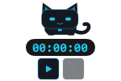

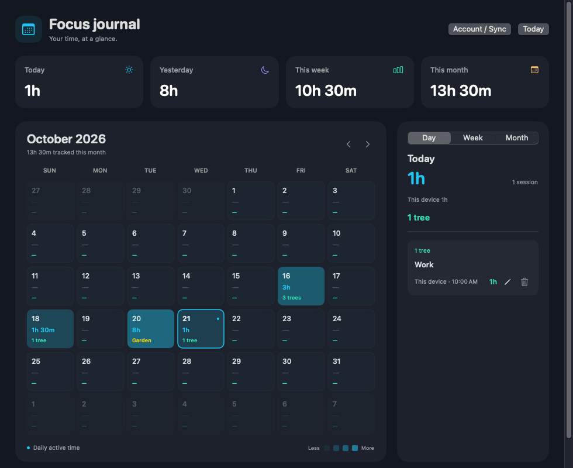

### Windows

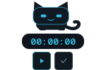

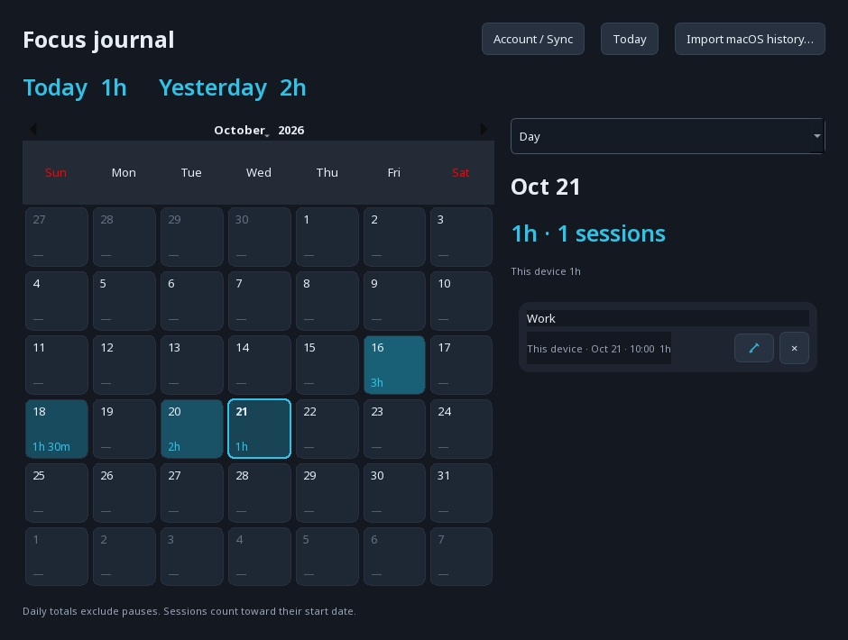

### Ubuntu

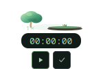

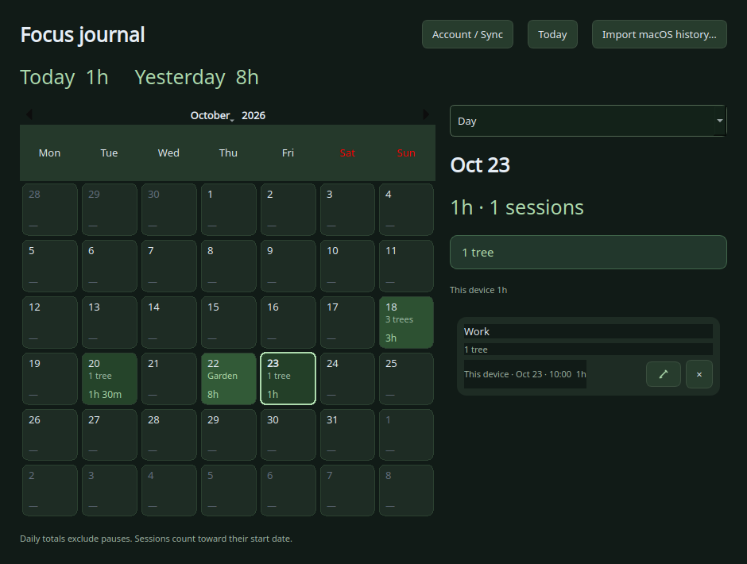

| Action | Android | macOS | Windows / Ubuntu GNOME |
|---|---|---|---|
| Show/hide floating tree | Settings / floating × | ⌘R | Ctrl+R |
| Start/resume | ▶ / notification | ⌘S | Ctrl+S |
| Pause | Ⅱ / notification | ⌘P | Ctrl+P |
| Finish | ✓ / notification | ⌘F | Ctrl+F |

Desktop S/P/F shortcuts are active only while the floating tree is visible. On Ubuntu/GNOME, enable the app’s Ctrl shortcuts once from floating controls. GNOME/Wayland can restrict placement and always-on-top behavior; other Linux desktops support local/manual bindings. See the [desktop guide](desktop/README.md).

## Engineering

| Layer | Implementation |
|---|---|
| Primary Android app | Kotlin, native Views and Canvas, foreground service, Notification chronometer, WindowManager overlay |
| Timing | `SystemClock.elapsedRealtime()` on Android, ContinuousClock on macOS, monotonic clocks on desktop |
| Local persistence | Android AtomicFile JSON and lifecycle checkpoints; native platform storage on desktop |
| Shared backend | Supabase account gateway, PostgreSQL, owner-only RLS policies, revision-based session sync |
| Authentication | Username + four-digit PIN via a rate-limited server gateway; PIN is not stored on devices |
| Credentials | Android Keystore encryption, macOS Keychain, Windows/Linux OS credential vault |
| Sync consistency | Stable session UUIDs, retained tombstones, offline outbox, explicit conflict choices |
| Rewards | Derived from session durations; no separate counters or reward schema to drift |
| Delivery | Per-OS GitHub Actions builds, tests, packaged smoke checks, versioned releases and SHA-256 manifests |

For a résumé: **“Built Focanopy, an Android-first focus tracker with animated tree rewards, accurate background timing, floating controls, calendar analytics and secure cross-platform offline sync using Kotlin and Supabase.”**

## Build and verify

| Platform | Command |
|---|---|
| Android | `cd android && ./gradlew :app:assembleDebug :app:testDebugUnitTest :app:lintDebug` |
| macOS | `cd macos && ./test.sh && ./build.sh` (`CYBERCAT_UNIVERSAL=1` builds both architectures) |
| Windows | `desktop\build-windows.cmd` on Windows |
| Ubuntu | `cd desktop && ./build-linux.sh` on Ubuntu |

[Android setup and isolated end-to-end tests](android/README.md) · [macOS guide](macos/README.md) · [Desktop guide](desktop/README.md) · [Backend and sync](backend/README.md)

Android MVP instrumentation covers notification controls, real category/custom naming, retained draft names, rename/delete/undo, activity recreation, JSON export, granted overlays, denied-overlay fallback and paused-timer process recovery. JVM tests cover timing, formatting and forest milestones. macOS model tests and Windows/Linux model/widget/packaged checks run separately. Platform screenshots are rendered from the real native views.

Physical OEM battery restrictions, deep-sleep/reboot behavior and Google Play review have not been validated on physical devices. Force stop can stop Android’s service; reopen the app to restore its checkpoint. There is no email recovery for PIN accounts. Local-only mode remains available.

## Upgrade compatibility

Focanopy was previously named **Cyber Cat**. The repository URL and internal package/storage/credential identifiers remain stable so existing installations, accounts and history continue working. Download filenames and visible branding now use Focanopy.

## License

Application source: [MIT](LICENSE). Desktop dependencies retain their own licenses; see [third-party notices](desktop/THIRD_PARTY.md).
